# 架構圖與流程圖 (Architecture Diagrams)

> 本文檔使用視覺化圖表說明 Data Analyzer 的系統架構、數據流和關鍵流程。

> 💡 **提示**：本文檔中的圖表使用 [Mermaid](https://mermaid.js.org/) 語法，在 GitHub、VS Code (with插件)、Notion 等平台上可以直接渲染。

---

## 📐 目錄

1. [系統整體架構](#1-系統整體架構)
2. [前端架構](#2-前端架構)
3. [後端架構](#3-後端架構)
4. [數據庫設計](#4-數據庫設計)
5. [數據流轉換](#5-數據流轉換)
6. [5步驟工作流](#6-5步驟工作流)
7. [WebSocket 協作流程](#7-websocket-協作流程)
8. [API 請求流程](#8-api-請求流程)

---

## 1. 系統整體架構

### 1.1 High-Level 架構圖

```mermaid
graph TB
    subgraph "前端 Frontend (React SPA)"
        A[瀏覽器 Browser]
        B[React 應用]
        C[Component Layer]
        D[Service Layer]
        E[Context State]
    end

    subgraph "後端 Backend (Node.js + Express)"
        F[Express Server]
        G[REST API]
        H[WebSocket Server]
        I[Service Layer]
        J[Database Layer]
    end

    subgraph "數據存儲 Data Storage"
        K[(SQLite DB)]
        L[/uploads/ 文件存儲]
        M[/exports/ 匯出文件]
    end

    A --> |HTTP/WebSocket| B
    B --> C
    C --> D
    D --> |Axios| G
    D --> |Socket.io-client| H
    E -.管理狀態.-> C

    F --> G
    F --> H
    G --> I
    H --> I
    I --> J
    J --> K
    I --> L
    I --> M

    style A fill:#e1f5ff
    style B fill:#fff3cd
    style F fill:#d4edda
    style K fill:#f8d7da
```

### 1.2 技術棧架構

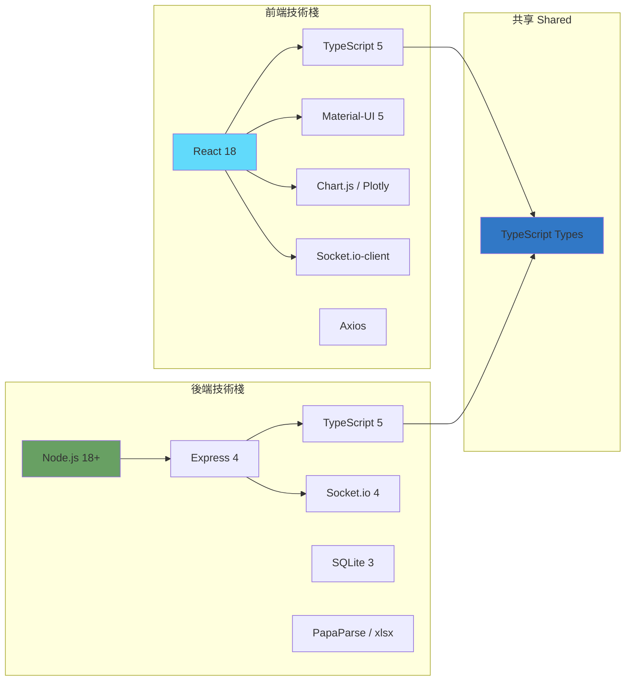

### 1.3 部署架構

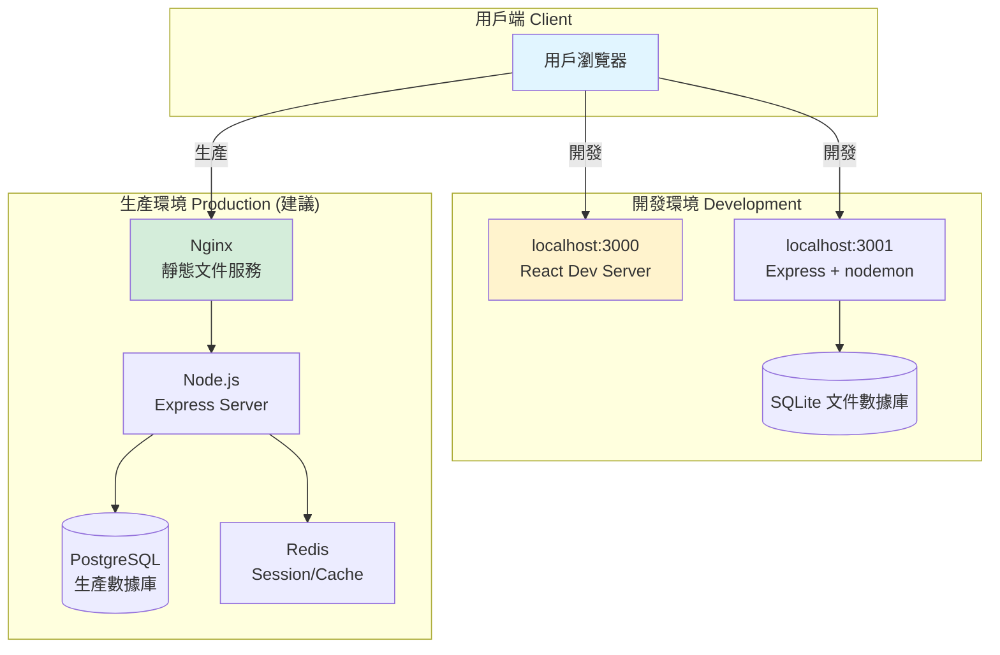

---

## 2. 前端架構

### 2.1 組件層級結構

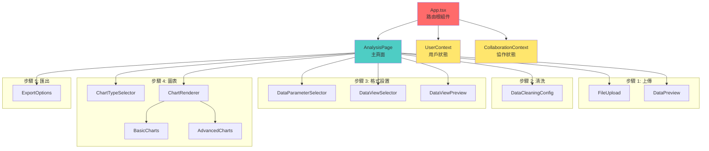

### 2.2 狀態管理流程

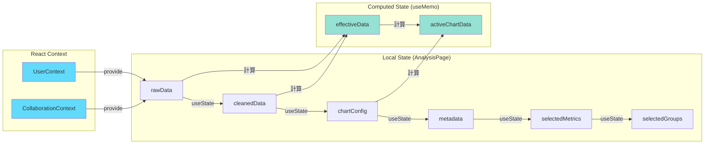

### 2.3 數據流向（前端）

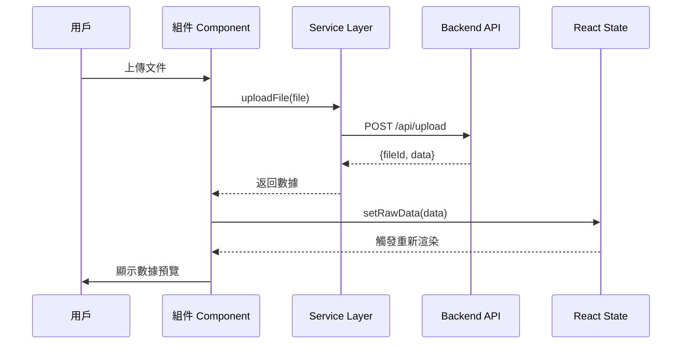

---

## 3. 後端架構

### 3.1 MVC 架構層級

```mermaid
graph TB
    subgraph "Entry Point"
        A[index.ts<br/>Express App 初始化]
    end

    subgraph "Middleware Layer"
        B1[helmet - 安全頭]
        B2[cors - 跨域]
        B3[rate-limit - 限流]
        B4[body-parser - 請求解析]
        B5[morgan - 日誌]
    end

    subgraph "Routes Layer"
        C1[/api/upload]
        C2[/api/data]
        C3[/api/charts]
        C4[/api/export]
        C5[/api/projects]
    end

    subgraph "Controllers Layer"
        D1[uploadController]
        D2[dataController]
        D3[chartController]
        D4[exportController]
        D5[projectController]
    end

    subgraph "Services Layer"
        E1[dataCleaningService]
        E2[exportService]
        E3[collaborationService]
        E4[batchAnalysisService]
    end

    subgraph "Utils / Database"
        F1[database.ts]
        F2[fileUpload.ts]
        F3[validation.ts]
    end

    A --> B1
    B1 --> B2
    B2 --> B3
    B3 --> B4
    B4 --> B5
    B5 --> C1
    B5 --> C2
    B5 --> C3
    B5 --> C4
    B5 --> C5

    C1 --> D1
    C2 --> D2
    C3 --> D3
    C4 --> D4
    C5 --> D5

    D1 --> E1
    D2 --> E1
    D4 --> E2
    D5 --> E3

    E1 --> F1
    E2 --> F1
    E3 --> F1
    D1 --> F2
    D1 --> F3

    style A fill:#ff6b6b
    style E1 fill:#4ecdc4
    style F1 fill:#ffe66d
```

### 3.2 API 端點結構

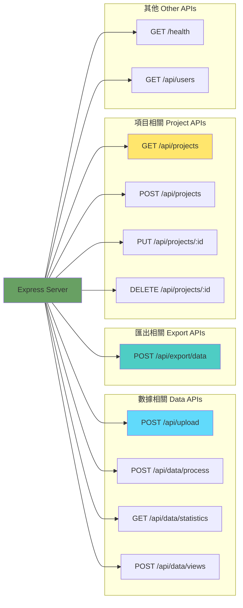

---

## 4. 數據庫設計

### 4.1 ER 關係圖

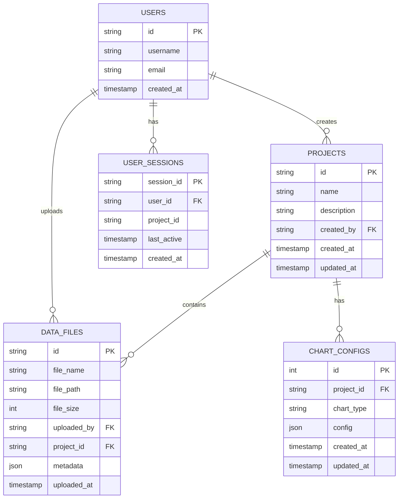

### 4.2 數據表詳細結構

#### users 表
| 欄位 | 類型 | 說明 | 約束 |
|------|------|------|------|
| id | TEXT | 用戶 ID | PRIMARY KEY |
| username | TEXT | 用戶名 | NOT NULL, UNIQUE |
| email | TEXT | 電子郵件 | UNIQUE |
| created_at | DATETIME | 創建時間 | DEFAULT CURRENT_TIMESTAMP |

#### data_files 表
| 欄位 | 類型 | 說明 | 約束 |
|------|------|------|------|
| id | TEXT | 文件 ID | PRIMARY KEY |
| file_name | TEXT | 原始文件名 | NOT NULL |
| file_path | TEXT | 服務器路徑 | NOT NULL |
| file_size | INTEGER | 文件大小 (bytes) | |
| uploaded_by | TEXT | 上傳者 ID | FOREIGN KEY |
| metadata | TEXT | JSON 格式元數據 | |
| uploaded_at | DATETIME | 上傳時間 | DEFAULT CURRENT_TIMESTAMP |

---

## 5. 數據流轉換

### 5.1 完整數據流程

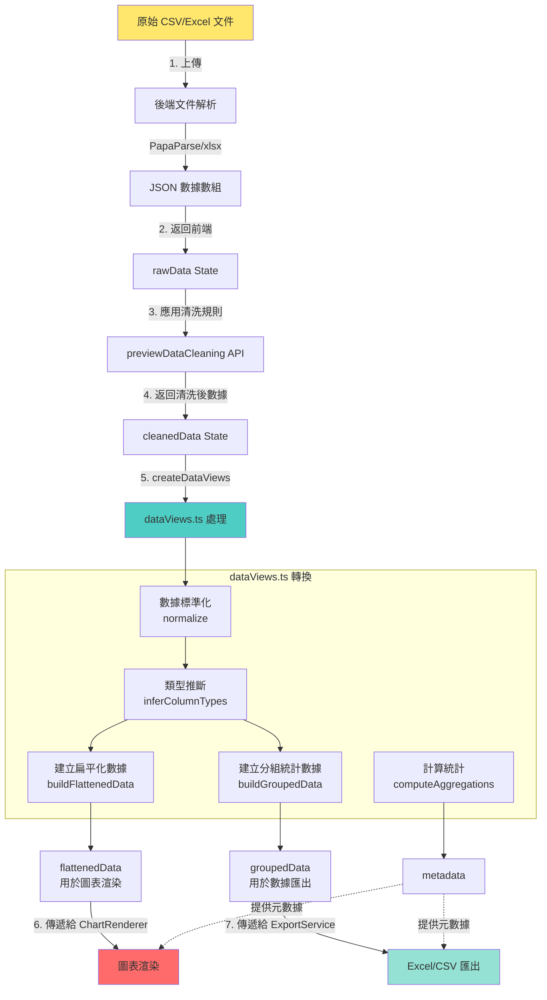

### 5.2 dataViews.ts 轉換詳解

```mermaid
graph TB
    A[InputRow[]]

    subgraph "Step 1-2: 標準化"
        B1[檢查 Point_ID 存在性]
        B2[解析 Source_File]
        B3[標準化 Point_ID 格式]
    end

    subgraph "Step 3-4: 類型推斷"
        C1[掃描所有欄位值]
        C2[計算數值比例]
        C3[分類為 numeric/categorical]
        C4[應用用戶覆寫]
    end

    subgraph "Step 5-7: 確定欄位"
        D1[選擇 metrics]
        D2[選擇 groups]
        D3[選擇 categoricalMetrics]
    end

    subgraph "Step 8: 構建數據格式"
        E1[buildFlattenedData<br/>保留所有記錄<br/>用於圖表渲染]
        E2[buildGroupedData<br/>聚合統計<br/>用於數據匯出]
    end

    subgraph "Step 9-10: 統計與元數據"
        F1[computeOverallAggregations]
        F2[組裝 metadata]
    end

    G[BatchViewResult<br/>{flattenedData, groupedData, metadata}]

    A --> B1
    B1 --> B2
    B2 --> B3
    B3 --> C1
    C1 --> C2
    C2 --> C3
    C3 --> C4
    C4 --> D1
    D1 --> D2
    D2 --> D3
    D3 --> E1
    D3 --> E2
    E1 --> F1
    E2 --> F1
    F1 --> F2
    F2 --> G

    style A fill:#ffe66d
    style C3 fill:#4ecdc4
    style E1 fill:#95e1d3
    style E2 fill:#95e1d3
    style G fill:#ff6b6b
```

### 5.3 數據格式對比

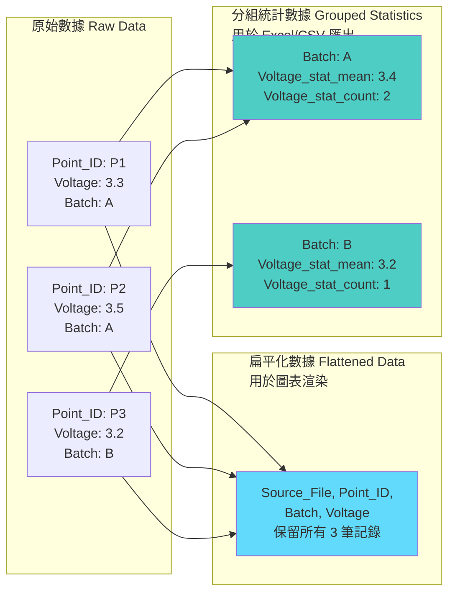

**重要概念釐清：**
- **Flattened Data (扁平化數據)**：保留所有原始記錄，主要用於 **圖表渲染和 UI 顯示**
- **Grouped Statistics (分組統計數據)**：按分組欄位聚合，生成 `_stat_*` 後綴的統計欄位，主要用於 **Excel/CSV 匯出和統計報告**
- 圖表需要顯示原始數據點和趨勢，因此使用 flattenedData，而非預先計算的平均值

---

## 6. 5步驟工作流

### 6.1 完整流程圖

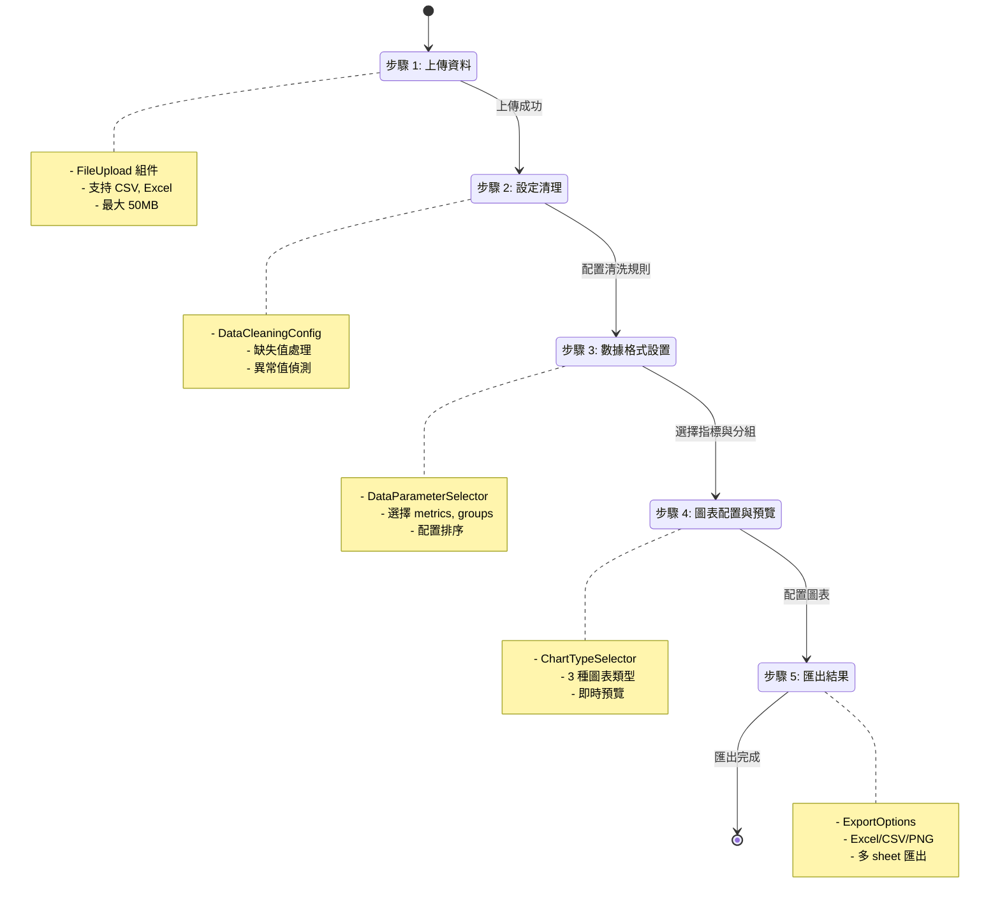

### 6.2 各步驟詳細流程

#### 步驟 1: 文件上傳流程

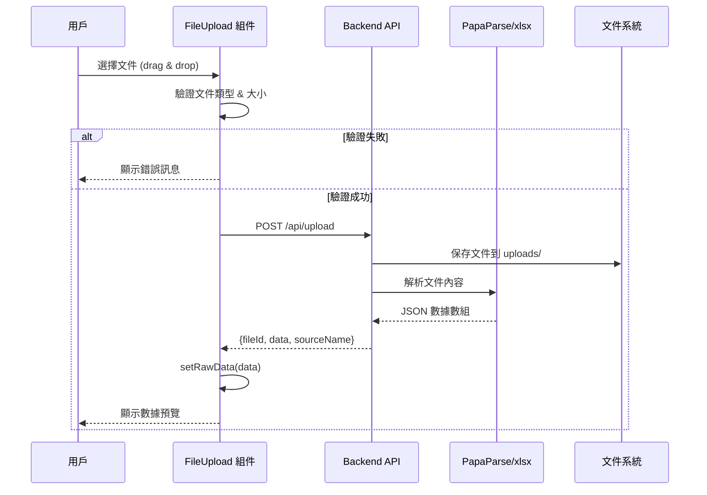

#### 步驟 2: 數據清洗流程

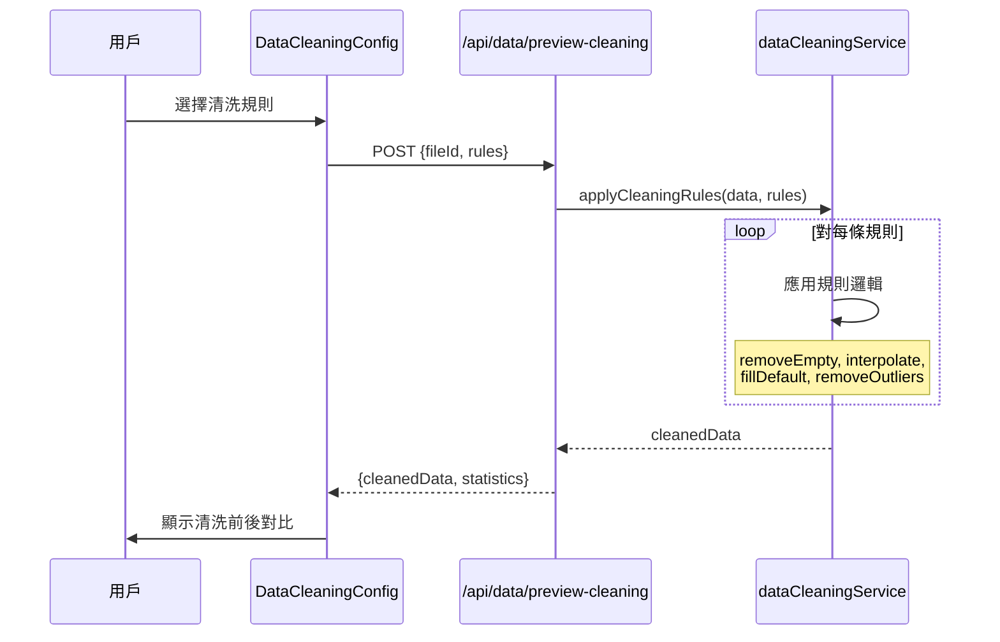

#### 步驟 3: 數據格式設置流程

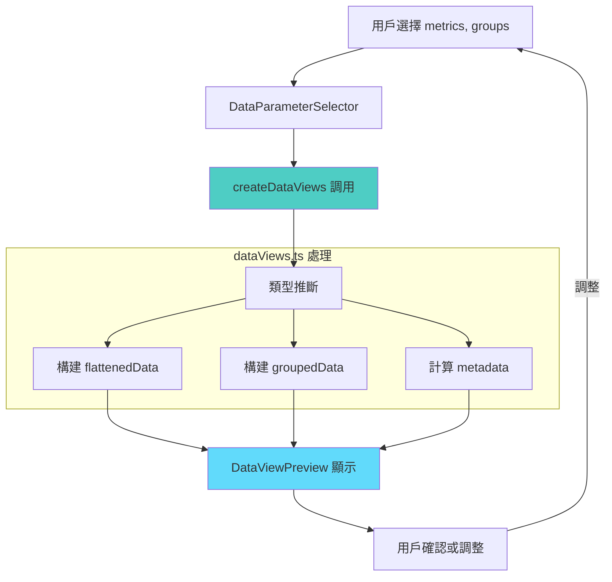

#### 步驟 4: 圖表配置流程

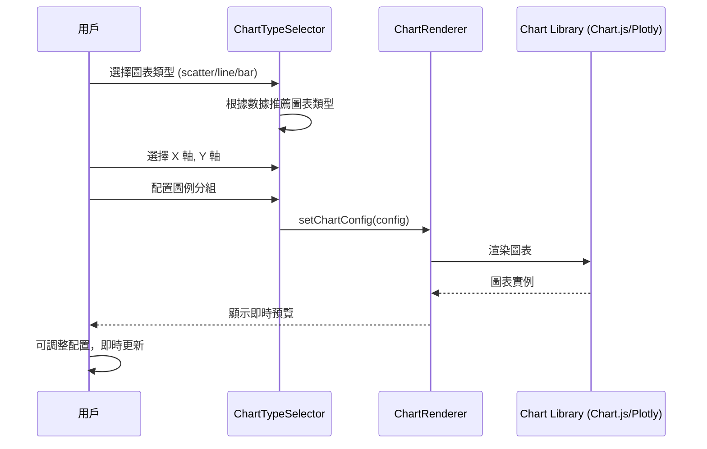

#### 步驟 5: 匯出流程

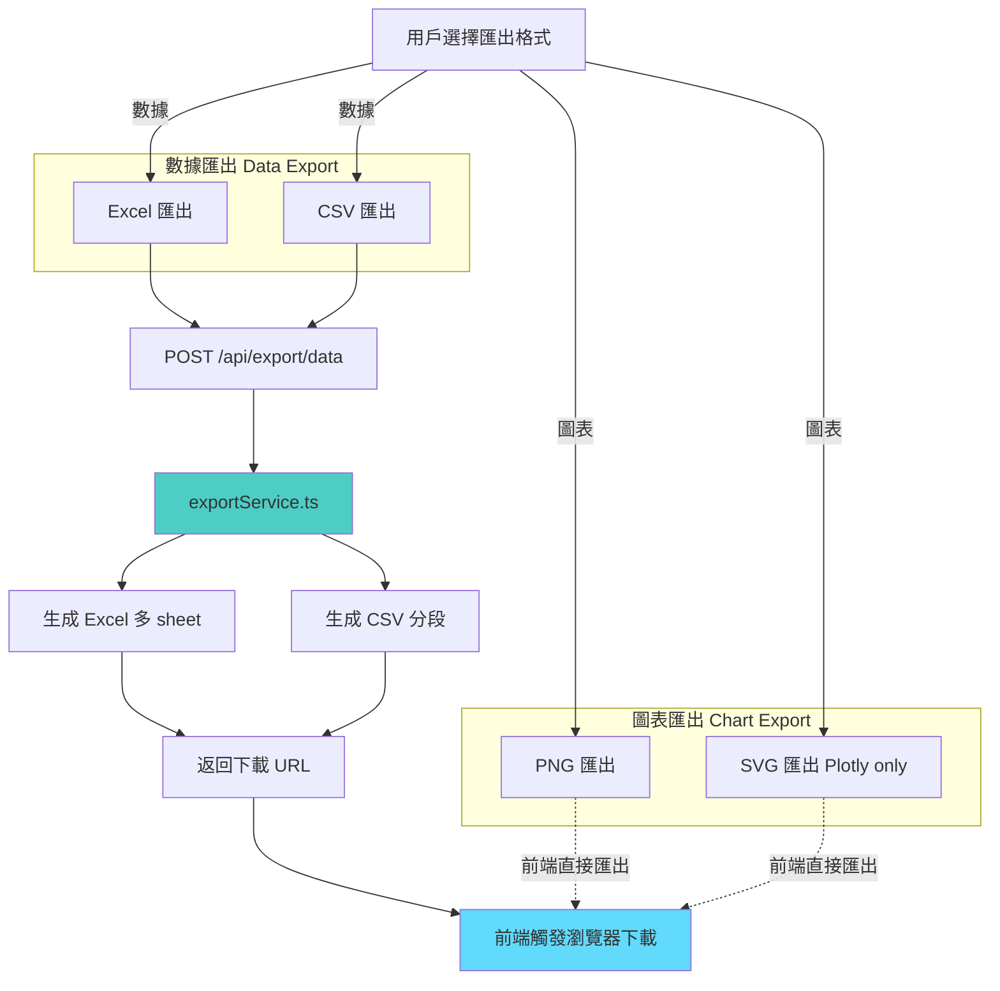

---

## 7. WebSocket 協作流程

### 7.1 協作連接生命週期

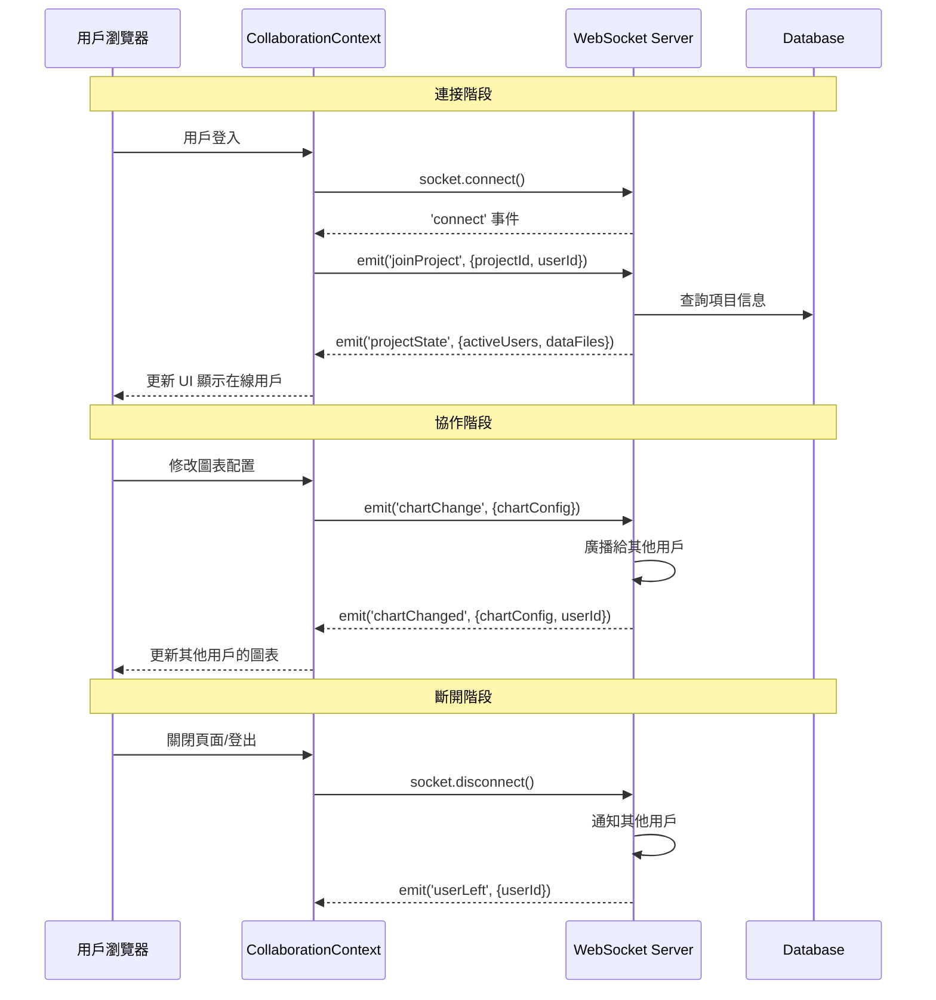

### 7.2 WebSocket 事件目錄

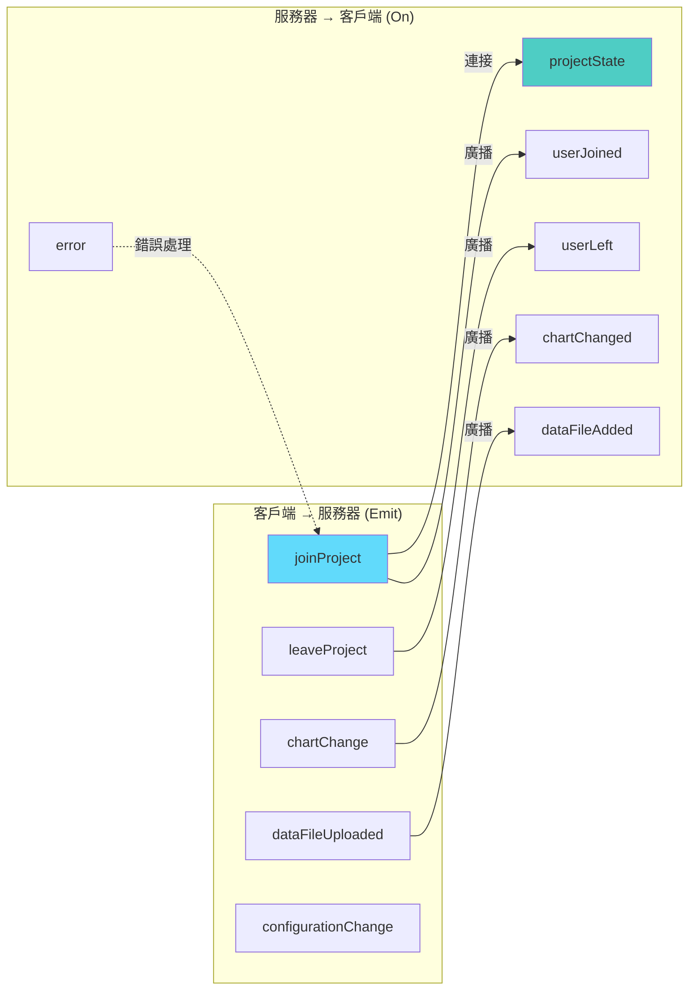

### 7.3 實時協作範例：圖表同步

```mermaid
sequenceDiagram
    participant U1 as 用戶 A
    participant U2 as 用戶 B
    participant WS as WebSocket Server

    U1->>WS: emit('chartChange', {type: 'scatter', xAxis: 'Voltage'})
    WS->>WS: 驗證配置
    WS->>U2: emit('chartChanged', {config, userId: 'A'})
    U2->>U2: 更新圖表顯示
    U2-->>U1: （通過 UI 看到 A 的變更）

    Note over U1,U2: 用戶 B 也可以修改
    U2->>WS: emit('chartChange', {type: 'line', yAxis: ['Current']})
    WS->>U1: emit('chartChanged', {config, userId: 'B'})
    U1->>U1: 更新圖表顯示
```

---

## 8. API 請求流程

### 8.1 典型 API 請求生命週期

```mermaid
sequenceDiagram
    participant C as 前端組件
    participant A as api.ts (Axios)
    participant M as Express 中間件
    participant R as Router
    participant Ctrl as Controller
    participant Svc as Service
    participant DB as Database

    C->>A: uploadFile(file)
    A->>M: POST /api/upload

    Note over M: 中間件鏈處理
    M->>M: helmet (安全頭)
    M->>M: cors (跨域)
    M->>M: rate-limit (限流)
    M->>M: body-parser (解析)

    M->>R: 路由匹配
    R->>Ctrl: uploadController.upload()
    Ctrl->>Ctrl: 驗證文件類型
    Ctrl->>Svc: 解析文件內容
    Svc->>DB: 保存文件記錄
    DB-->>Svc: 文件 ID
    Svc-->>Ctrl: {fileId, data}
    Ctrl-->>R: 200 OK + JSON
    R-->>M: 響應
    M-->>A: Axios 響應
    A-->>C: Promise resolved
    C->>C: 更新 state
```

### 8.2 錯誤處理流程

```mermaid
graph TD
    A[API 請求] --> B{驗證通過?}
    B -->|否| C[400 Bad Request]
    B -->|是| D{認證通過?}
    D -->|否| E[401 Unauthorized]
    D -->|是| F{業務邏輯處理}
    F -->|成功| G[200 OK]
    F -->|業務錯誤| H[400 Bad Request<br/>+ 詳細錯誤訊息]
    F -->|服務器錯誤| I[500 Internal Server Error]

    C --> J[前端顯示錯誤訊息]
    E --> J
    H --> J
    I --> J
    G --> K[前端處理成功響應]

    style C fill:#f8d7da
    style E fill:#f8d7da
    style H fill:#f8d7da
    style I fill:#f8d7da
    style G fill:#d4edda
```

### 8.3 常見 API 請求範例

#### 文件上傳 API

```mermaid
sequenceDiagram
    participant F as Frontend
    participant U as Upload Endpoint
    participant M as Multer
    participant P as Parser (PapaParse)
    participant FS as File System

    F->>U: POST /api/upload<br/>FormData: file
    U->>M: 處理 multipart/form-data
    M->>FS: 保存到 uploads/
    FS-->>M: 文件路徑
    M-->>U: req.file
    U->>P: 解析文件內容
    P-->>U: JSON data[]
    U-->>F: {fileId, data, sourceName}
```

#### 數據處理 API

```mermaid
sequenceDiagram
    participant F as Frontend
    participant D as Data Endpoint
    participant S as Cleaning Service

    F->>D: POST /api/data/process<br/>{fileId, rules}
    D->>S: applyCleaningRules(data, rules)

    loop 每條規則
        S->>S: 處理數據
    end

    S-->>D: cleanedData
    D-->>F: {cleanedData, statistics}
```

---

## 9. 性能優化策略

### 9.1 前端性能優化

```mermaid
graph LR
    subgraph "渲染優化"
        A1[useMemo<br/>緩存計算結果]
        A2[useCallback<br/>緩存函數引用]
        A3[React.memo<br/>避免不必要渲染]
    end

    subgraph "數據優化"
        B1[虛擬滾動<br/>大量數據列表]
        B2[分頁<br/>減少 DOM 節點]
        B3[懶加載<br/>按需加載組件]
    end

    subgraph "網路優化"
        C1[Axios 攔截器<br/>統一錯誤處理]
        C2[請求取消<br/>避免重複請求]
        C3[WebSocket<br/>減少輪詢]
    end

    A1 -.應用於.-> D[effectiveData]
    A2 -.應用於.-> E[事件處理器]
    B1 -.應用於.-> F[DataPreview]
    C3 -.應用於.-> G[實時協作]

    style A1 fill:#61dafb
    style B1 fill:#4ecdc4
    style C3 fill:#ffe66d
```

### 9.2 後端性能優化

```mermaid
graph LR
    subgraph "數據庫優化"
        A1[索引優化]
        A2[查詢優化]
        A3[連接池]
    end

    subgraph "緩存策略"
        B1[內存緩存<br/>Map/Object]
        B2[Redis<br/>生產環境]
        B3[文件緩存<br/>已解析數據]
    end

    subgraph "並發處理"
        C1[限流中間件<br/>rate-limit]
        C2[異步處理<br/>Promise.all]
        C3[批量操作<br/>減少查詢]
    end

    A1 -.應用於.-> D[users, data_files]
    B3 -.應用於.-> E[uploads/ 文件]
    C1 -.應用於.-> F[所有 API]

    style A1 fill:#68a063
    style B2 fill:#4ecdc4
    style C1 fill:#ffe66d
```

---

## 10. 安全架構

### 10.1 安全層級

```mermaid
graph TB
    subgraph "前端安全 Frontend Security"
        A1[XSS 防護<br/>React 自動轉義]
        A2[HTTPS Only<br/>生產環境]
        A3[輸入驗證<br/>客戶端]
    end

    subgraph "網路安全 Network Security"
        B1[CORS 配置<br/>限制來源]
        B2[Rate Limiting<br/>防止 DoS]
        B3[Helmet<br/>安全 HTTP 頭]
    end

    subgraph "後端安全 Backend Security"
        C1[輸入驗證<br/>服務器端]
        C2[文件類型驗證<br/>白名單]
        C3[文件大小限制<br/>50MB]
        C4[SQL 注入防護<br/>參數化查詢]
    end

    subgraph "數據安全 Data Security"
        D1[敏感數據加密]
        D2[Session 管理]
        D3[定期清理<br/>臨時文件]
    end

    A1 --> B1
    A3 --> C1
    B2 --> C1
    C1 --> D1
    C2 --> D3

    style A1 fill:#d4edda
    style B1 fill:#cfe2ff
    style C1 fill:#fff3cd
    style D1 fill:#f8d7da
```

---

## 📝 圖表使用說明

### 如何查看這些圖表

1. **GitHub** - 直接在 GitHub 上查看 .md 文件，Mermaid 會自動渲染
2. **VS Code** - 安裝 "Markdown Preview Mermaid Support" 擴展
3. **Notion** - 將 Mermaid 代碼粘貼到代碼塊中，選擇 "Mermaid" 語言
4. **在線編輯器** - https://mermaid.live/ 可以編輯和預覽

### 圖表類型說明

- **graph TD/LR** - 流程圖 (上到下/左到右)
- **sequenceDiagram** - 序列圖 (時序圖)
- **erDiagram** - ER 關係圖 (數據庫設計)
- **stateDiagram** - 狀態圖 (工作流狀態)

---

## 🔗 相關文檔

- [開發者快速上手指南](./DEVELOPER_ONBOARDING.md) - 入門學習路徑
- [API 參考文檔](./API_REFERENCE.md) - API 端點詳細說明
- [代碼範例集](./CODE_EXAMPLES.md) - 常見開發任務範例
- [系統架構文檔](./ARCHITECTURE.md) - 詳細架構說明

---

*最後更新：2025-01-13*
*維護者：開發團隊*
*回饋：如有圖表錯誤或建議，請提交 Issue*
