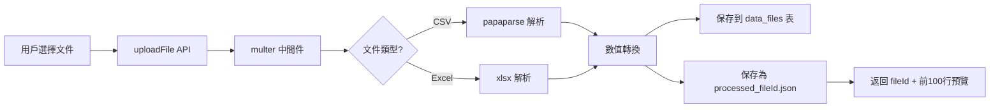
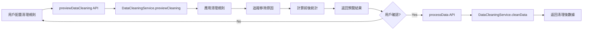
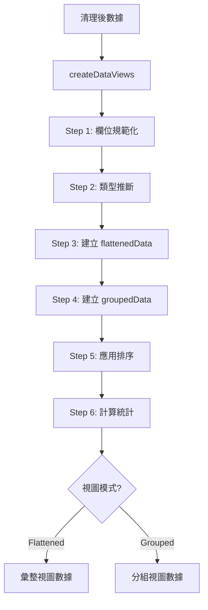
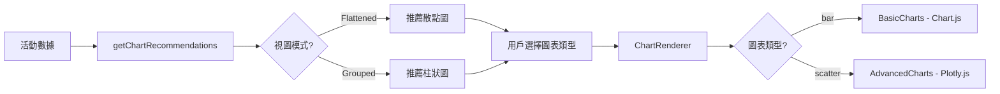
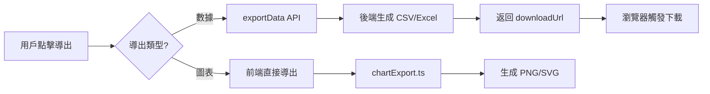
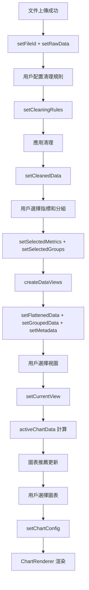

# 數據流向指南 (Data Flow Guide)

> **目標讀者**: Junior programmers, 新加入的team members
> **更新日期**: 2025-11-14

## 目錄 (Table of Contents)

1. [概述 (Overview)](#概述-overview)
2. [完整數據流程 (Complete Data Flow)](#完整數據流程-complete-data-flow)
3. [各階段詳解 (Stage Details)](#各階段詳解-stage-details)
4. [關鍵數據結構 (Key Data Structures)](#關鍵數據結構-key-data-structures)
5. [狀態管理流程 (State Management Flow)](#狀態管理流程-state-management-flow)

---

## 概述 (Overview)

DataAnalyzer 是一個數據分析平台，支援文件上傳、數據清理、數據轉換、統計分析和圖表可視化的完整工作流。

### 核心流程 (Core Flow)

```
文件上傳 → 數據解析 → 數據清理 → 數據轉換 → 統計分析 → 圖表生成 → 結果導出
 Upload  →  Parsing  → Cleaning → Transform → Statistics →  Charts   →  Export
```

---

## 完整數據流程 (Complete Data Flow)

### 階段 1: 文件上傳與解析 (File Upload & Parsing)



**關鍵文件**:
- Frontend: `AnalysisPage.tsx` (Step 1: File Upload)
- Backend: `uploadController.ts` → `uploadFile()`
- Storage: `uploads/processed_{fileId}.json`

**數據格式**:
```typescript
// 輸入: File object (from <input type="file">)
// 輸出: { fileId: string, data: DataPoint[] }
// DataPoint = Record<string, unknown>
```

---

### 階段 2: 數據清理 (Data Cleaning)



**清理規則處理順序**:
1. **數值範圍過濾** (minValue, maxValue)
2. **異常值檢測** (IQR 或 Z-Score)
3. **缺失值處理** (skip, remove, default)

**關鍵文件**:
- Frontend: `DataCleaningConfig.tsx`
- Backend: `dataCleaningService.ts`
- API: `previewDataCleaning()`, `processData()`

**數據格式**:
```typescript
// CleaningRule
{
  field: string;
  enabled: boolean;
  minValue?: number;
  maxValue?: number;
  removeOutliers?: boolean;
  outlierMethod?: 'iqr' | 'zscore';
  handleMissing?: 'skip' | 'remove' | 'default';
  defaultValue?: any;
}
```

---

### 階段 3: 數據轉換與視圖建立 (Data Transform & View Creation)



**數據轉換核心**: `dataViews.ts` → `createDataViews()`

**8大處理步驟**:
1. **欄位規範化**: 統一欄位名稱格式 (Batch_No, Point_ID 等)
2. **類型推斷**: 自動識別數值型/分類型欄位
3. **統計計算**: 對數值型欄位計算 mean, min, max, std 等
4. **扁平化**: 展開巢狀結構為平面表格
5. **分組**: 按指定欄位分組並聚合統計指標
6. **分類處理**: 標記分類型欄位 (Batch_No, Point_ID)
7. **元數據生成**: 產生 columnMeta, dataStats 等
8. **排序應用**: 應用主要和次要排序

**關鍵配置選項**:
```typescript
{
  flattenParams: string[];        // 要展開的統計欄位
  groupParams: string[];          // 分組欄位
  categoricalMetrics: string[];   // 強制分類型欄位
  columnTypeOverrides: Record<string, 'numeric' | 'categorical'>;
  primarySort: string;            // 主要排序欄位
  secondarySort: string;          // 次要排序欄位
}
```

---

### 階段 4: 圖表生成 (Chart Generation)



**圖表推薦邏輯** (`chartRecommendations.ts`):

#### 分組視圖 (Grouped View)
- **柱狀圖** (優先級 5): 比較各組的聚合指標
- **散點圖** (優先級 3): 展示分組內數據分佈

#### 彙整視圖 (Flattened View)
- **散點圖** (優先級 5): 展示兩個數值欄位的相關性
- **柱狀圖** (優先級 3): 分組統計分析

**圖表引擎分配**:
- **BasicCharts** (Chart.js): 輕量、快速 → `bar` 柱狀圖
- **AdvancedCharts** (Plotly.js): 強大交互 → `scatter` 散點圖

**關鍵文件**:
- `ChartRenderer.tsx`: 圖表調度器
- `chartRecommendations.ts`: 推薦邏輯
- `BasicCharts.tsx`, `AdvancedCharts.tsx`: 圖表引擎

---

### 階段 5: 數據導出 (Data Export)



**數據導出選項**:
```typescript
{
  format: 'csv' | 'xlsx';
  includeStatistics: boolean;     // 包含統計工作表
  filename: string;                // 自定義文件名
  metadata: any;                   // 元數據 (項目信息等)
  flattenedData: DataPoint[];      // 彙整數據
  groupedData: DataPoint[];        // 分組數據
  primarySort: string;             // 主要排序
  secondarySort: string;           // 次要排序
}
```

---

## 各階段詳解 (Stage Details)

### 數據清理階段詳細流程

#### 1. 預覽清理效果
```typescript
// 用戶在 DataCleaningConfig 配置規則
const rules: CleaningRule[] = [
  {
    field: 'Voltage',
    enabled: true,
    minValue: 3.0,
    maxValue: 4.2,
    removeOutliers: true,
    outlierMethod: 'iqr',
    handleMissing: 'remove'
  }
];

// 調用預覽 API
const preview = await previewDataCleaning(rawData, rules);

// preview.data 包含:
// - cleanedData: 清理後數據 (前100行)
// - originalCount: 原始行數
// - cleanedCount: 清理後行數
// - removedCount: 移除行數
// - retentionRate: 保留率 (%)
// - removedRows: 被移除的行 + 移除原因
// - originalStatistics: 清理前統計
// - cleanedStatistics: 清理後統計
```

#### 2. 應用清理規則
```typescript
// 用戶確認後，應用清理
const result = await processData(fileId, rules);

// result.data: 完整的清理後數據
// 此數據會傳入 AnalysisPage 的 cleanedData state
```

---

### 數據轉換階段詳細流程

#### 1. createDataViews 輸入與輸出

**輸入**:
```typescript
// genericRows: 原始或清理後的數據
const genericRows: Array<Record<string, unknown>> = [
  { Batch_No: 'A1', Voltage: 3.7, Current: 2.1 },
  { Batch_No: 'A1', Voltage: 3.8, Current: 2.0 },
  { Batch_No: 'A2', Voltage: 3.6, Current: 2.2 }
];

// options: 轉換配置
const options = {
  flattenParams: ['Voltage_stat', 'Current_stat'],
  groupParams: ['Batch_No'],
  categoricalMetrics: ['Batch_No'],
  columnTypeOverrides: {},
  primarySort: 'Batch_No',
  secondarySort: null
};
```

**輸出**:
```typescript
{
  flattenedData: [
    { Batch_No: 'A1', Voltage_stat_mean: 3.75, Voltage_stat_std: 0.07, ... },
    { Batch_No: 'A2', Voltage_stat_mean: 3.6, Voltage_stat_std: 0, ... }
  ],
  groupedData: [
    { Batch_No: 'A1', count: 2, Voltage_mean: 3.75, Current_mean: 2.05 },
    { Batch_No: 'A2', count: 1, Voltage_mean: 3.6, Current_mean: 2.2 }
  ],
  metadata: {
    columnMeta: {
      Batch_No: { type: 'categorical', ... },
      Voltage: { type: 'numeric', ... }
    },
    dataStats: {
      Voltage: { mean: 3.7, min: 3.6, max: 3.8, std: 0.1 },
      ...
    },
    ...
  }
}
```

---

## 關鍵數據結構 (Key Data Structures)

### DataPoint
```typescript
// 最基本的數據單位
type DataPoint = Record<string, unknown>;

// 示例
const dataPoint: DataPoint = {
  Batch_No: 'A1',
  Point_ID: 'P1',
  Voltage: 3.7,
  Current: 2.1,
  Temperature: 25.5
};
```

### CleaningRule
```typescript
interface CleaningRule {
  field: string;               // 要清理的欄位名稱
  enabled: boolean;            // 是否啟用此規則
  minValue?: number;           // 最小值範圍
  maxValue?: number;           // 最大值範圍
  removeOutliers?: boolean;    // 是否移除異常值
  outlierMethod?: 'iqr' | 'zscore';  // 異常值檢測方法
  handleMissing?: 'skip' | 'remove' | 'default';  // 缺失值處理策略
  defaultValue?: any;          // 默認值 (handleMissing='default' 時使用)
}
```

### ChartConfig
```typescript
interface ChartConfig {
  type: 'bar' | 'scatter';     // 圖表類型
  xAxis: string;               // X軸欄位
  yAxis: string | string[];    // Y軸欄位 (可多個)
  groupBy?: string;            // 分組欄位 (scatter 使用)
  title?: string;              // 圖表標題
}
```

### ApiResponse
```typescript
interface ApiResponse<T = any> {
  success: boolean;            // 請求是否成功
  data?: T;                    // 返回的數據
  message?: string;            // 成功或錯誤訊息
  timestamp: string;           // ISO 時間戳
}
```

---

## 狀態管理流程 (State Management Flow)

### AnalysisPage 核心狀態

```typescript
const AnalysisPage = () => {
  // Step 1: 文件上傳
  const [fileId, setFileId] = useState<string | null>(null);
  const [rawData, setRawData] = useState<DataPoint[]>([]);

  // Step 2: 數據清理
  const [cleaningRules, setCleaningRules] = useState<CleaningRule[]>([]);
  const [cleanedData, setCleanedData] = useState<DataPoint[]>([]);

  // Step 3: 數據轉換
  const [selectedMetrics, setSelectedMetrics] = useState<string[]>([]);
  const [selectedGroups, setSelectedGroups] = useState<string[]>([]);
  const [flattenedData, setFlattenedData] = useState<DataPoint[]>([]);
  const [groupedData, setGroupedData] = useState<DataPoint[]>([]);
  const [metadata, setMetadata] = useState<any>(null);

  // Step 4: 視圖選擇
  const [currentView, setCurrentView] = useState<'flattened' | 'grouped'>('flattened');

  // Step 5: 圖表配置
  const [chartConfig, setChartConfig] = useState<ChartConfig | null>(null);

  // ...
};
```

### 狀態更新流程



---

## 實際案例：完整流程示例

### 場景：電池數據分析

#### 1. 上傳文件
```typescript
// 用戶上傳 battery_data.csv
const file = event.target.files[0];
const result = await uploadFile(file);
// fileId = "abc-123-def-456"
// rawData = [前100行預覽]
```

#### 2. 配置清理規則
```typescript
const rules = [
  {
    field: 'Voltage',
    enabled: true,
    minValue: 3.0,
    maxValue: 4.2,
    removeOutliers: true,
    outlierMethod: 'iqr',
    handleMissing: 'remove'
  },
  {
    field: 'Current',
    enabled: true,
    handleMissing: 'default',
    defaultValue: 0
  }
];

// 預覽清理效果
const preview = await previewDataCleaning(rawData, rules);
// 保留率: 85% (1000行 → 850行)

// 確認並應用
const cleaned = await processData(fileId, rules);
// cleanedData = 850行清理後數據
```

#### 3. 選擇指標和分組
```typescript
// 用戶選擇:
// - 指標: Voltage_stat, Current_stat
// - 分組: Batch_No
// - 排序: Batch_No (主要)

const { flattenedData, groupedData, metadata } = createDataViews(cleaned, {
  flattenParams: ['Voltage_stat', 'Current_stat'],
  groupParams: ['Batch_No'],
  primarySort: 'Batch_No'
});

// flattenedData: 展開統計欄位的扁平化數據
// groupedData: 按 Batch_No 分組的聚合數據
```

#### 4. 生成圖表
```typescript
// 切換到分組視圖
setCurrentView('grouped');

// 圖表推薦: 柱狀圖 (優先級 5)
const recommendations = getChartRecommendations(
  groupedData,
  metadata,
  'grouped'
);

// 用戶選擇柱狀圖
const config: ChartConfig = {
  type: 'bar',
  xAxis: 'Batch_No',
  yAxis: ['Voltage_mean', 'Current_mean'],
  title: '各批次平均電壓和電流'
};

// ChartRenderer 渲染
// → BasicCharts (Chart.js) 渲染柱狀圖
```

#### 5. 導出結果
```typescript
// 導出 Excel，包含統計信息
const result = await exportData(groupedData, 'xlsx', {
  includeStatistics: true,
  filename: 'battery_analysis_2024',
  metadata: {
    projectName: '電池數據分析',
    cleaningRules: rules,
    exportDate: new Date().toISOString()
  },
  flattenedData,
  groupedData,
  primarySort: 'Batch_No'
});

// 觸發下載
window.location.href = result.data.downloadUrl;
```

---

## 總結 (Summary)

### 數據流關鍵點

1. **單向數據流**: Upload → Clean → Transform → Visualize → Export
2. **狀態驅動**: React state 管理整個流程的數據和配置
3. **API 調用**: 前端通過 axios 調用後端 API
4. **數據轉換**: createDataViews 是核心轉換引擎
5. **圖表智能推薦**: 根據視圖模式和數據特徵自動推薦圖表類型

### Junior程序員需要掌握的核心文件

**Frontend**:
- `AnalysisPage.tsx`: 主要流程編排
- `dataViews.ts`: 數據轉換核心
- `api.ts`: API 調用層

**Backend**:
- `uploadController.ts`: 文件上傳處理
- `dataController.ts`: 數據處理端點
- `dataCleaningService.ts`: 清理邏輯實現

**共享**:
- `shared/types.ts`: 類型定義

---

## 延伸閱讀 (Further Reading)

- [COMPONENT_GUIDE.md](./COMPONENT_GUIDE.md) - 組件架構指南
- [COMMON_TASKS.md](./COMMON_TASKS.md) - 常見開發任務
- [TROUBLESHOOTING.md](./TROUBLESHOOTING.md) - 故障排查指南
- [CONTRIBUTING.md](../CONTRIBUTING.md) - 貢獻指南
