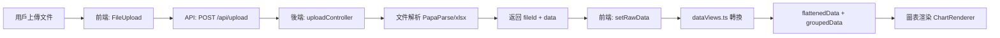

# 開發者快速上手指南 (Developer Onboarding Guide)

> 歡迎加入 Data Analyzer 專案！本指南將協助您在 3 天內熟悉專案並開始貢獻代碼。

## 📋 目標讀者

本指南專為以下開發者設計：
- **Junior Developer** - 具備基礎 JavaScript/TypeScript 和 React 知識
- **新團隊成員** - 熟悉 Web 開發但不了解本專案架構
- **貢獻者** - 想要為本專案做出貢獻的外部開發者

## 🎯 學習路徑概覽

| 天數 | 重點 | 目標 |
|------|------|------|
| **Day 1** | 環境設置 + 專案運行 | 能夠在本地運行完整應用 |
| **Day 2** | 專案架構理解 | 了解代碼組織和數據流 |
| **Day 3** | 實作第一個功能 | 完成一個簡單的 bug 修復或功能添加 |

---

## 🚀 Day 1: 環境設置與專案運行

### 1.1 前置需求檢查

在開始之前，請確認您的系統已安裝以下軟體：

```bash
# 檢查 Node.js 版本 (需要 >= 18.0.0)
node --version

# 檢查 npm 版本 (需要 >= 9.0.0)
npm --version

# 檢查 Git 版本
git --version
```

如果版本不符合要求，請先安裝或升級：
- [Node.js 下載](https://nodejs.org/) - 推薦使用 LTS 版本
- Git 通常隨 Node.js 一起安裝

### 1.2 克隆專案

```bash
# 克隆專案倉庫
git clone <repository-url>
cd dataanalyzer

# 檢視專案結構
tree -L 2  # Linux/Mac
dir /s    # Windows
```

### 1.3 安裝依賴

專案使用 **monorepo** 結構，包含三個主要部分：

```bash
# 方式一：使用自動化腳本（推薦）
# Windows
install.bat

# Linux/Mac
chmod +x install.sh
./install.sh

# 方式二：手動安裝
npm install                  # 安裝根目錄依賴
cd frontend && npm install   # 安裝前端依賴
cd ../backend && npm install # 安裝後端依賴
cd ../shared/types && npm run build  # 編譯共享類型
```

**安裝時間**：約 2-5 分鐘，取決於網路速度

### 1.4 環境配置

創建環境變數文件：

```bash
# 後端環境變數
cp backend/.env.example backend/.env

# 前端環境變數（如果需要）
cp frontend/.env.example frontend/.env
```

**後端 `.env` 關鍵配置：**
```env
PORT=3001
NODE_ENV=development
DATABASE_PATH=./data/analyzer.db
```

> 💡 **提示**：開發環境通常不需要修改預設配置

### 1.5 啟動應用

```bash
# 方式一：使用啟動腳本（推薦）
# Windows
start.bat

# Linux/Mac
chmod +x start.sh
./start.sh

# 方式二：手動啟動（用於調試）
# 終端 1 - 啟動後端
cd backend
npm run dev

# 終端 2 - 啟動前端
cd frontend
npm start
```

**預期結果：**
- ✅ 前端運行在 `http://localhost:3000`
- ✅ 後端運行在 `http://localhost:3001`
- ✅ 瀏覽器自動打開前端頁面
- ✅ 後端控制台顯示 "Server running on port 3001"

### 1.6 驗證安裝

執行以下檢查清單：

- [ ] 前端頁面正常顯示（有上傳按鈕和步驟指示器）
- [ ] 瀏覽器控制台無錯誤訊息
- [ ] 後端控制台顯示數據庫初始化成功
- [ ] 可以訪問 `http://localhost:3001/health`（返回 OK）

**測試功能：**
1. 上傳測試檔案（`data/` 目錄下的 CSV 文件）
2. 確認數據預覽顯示正常
3. 嘗試切換步驟

### 1.7 常見問題排除

| 問題 | 解決方案 |
|------|----------|
| **Port 3000/3001 已被佔用** | 查找並關閉佔用端口的程序，或修改 `.env` 中的 PORT |
| **模組找不到錯誤** | 刪除所有 `node_modules` 和 `package-lock.json`，重新執行 `npm install` |
| **TypeScript 編譯錯誤** | 執行 `cd shared/types && npm run build` |
| **數據庫錯誤** | 刪除 `backend/data/analyzer.db`，重新啟動後端 |

**尋求幫助：**
- 查看 `DEPLOYMENT_README.md` 的疑難排解章節
- 在團隊聊天頻道詢問
- 檢查 GitHub Issues 是否有類似問題

---

## 🏗️ Day 2: 專案架構理解

### 2.1 專案結構總覽

```
dataanalyzer/
├── frontend/              # React 前端應用
│   ├── src/
│   │   ├── components/    # React 組件
│   │   ├── pages/         # 頁面組件
│   │   ├── services/      # API 調用服務
│   │   ├── contexts/      # React Context (狀態管理)
│   │   ├── utils/         # 工具函數
│   │   └── types/         # TypeScript 類型定義
│   └── public/            # 靜態資源
│
├── backend/               # Node.js + Express 後端
│   ├── src/
│   │   ├── controllers/   # API 控制器（處理請求）
│   │   ├── services/      # 業務邏輯層
│   │   ├── routes/        # API 路由定義
│   │   ├── handlers/      # WebSocket 事件處理器
│   │   ├── middleware/    # 中間件（認證、錯誤處理等）
│   │   └── utils/         # 工具函數（數據庫、驗證等）
│   ├── uploads/           # 上傳文件存儲
│   └── exports/           # 匯出文件存儲
│
├── shared/                # 前後端共享代碼
│   └── types/             # 共享 TypeScript 類型
│
├── docs/                  # 文檔
└── data/                  # 測試數據文件
```

### 2.2 技術棧清單

#### 前端 (Frontend)
| 技術 | 版本 | 用途 | 學習資源 |
|------|------|------|----------|
| **React** | 18.2 | UI 框架 | [React Docs](https://react.dev) |
| **TypeScript** | 5.x | 類型安全 | [TS Handbook](https://www.typescriptlang.org/docs/) |
| **Material-UI** | 5.x | UI 組件庫 | [MUI Docs](https://mui.com) |
| **Chart.js** | 4.x | 圖表渲染 | [Chart.js Docs](https://www.chartjs.org/docs/) |
| **Plotly.js** | 2.x | 高級圖表 | [Plotly Docs](https://plotly.com/javascript/) |
| **Socket.io-client** | 4.x | 實時通訊 | [Socket.io Docs](https://socket.io/docs/) |

#### 後端 (Backend)
| 技術 | 版本 | 用途 | 學習資源 |
|------|------|------|----------|
| **Node.js** | 18+ | 執行環境 | [Node.js Docs](https://nodejs.org/docs/) |
| **Express** | 4.x | Web 框架 | [Express Docs](https://expressjs.com/) |
| **TypeScript** | 5.x | 類型安全 | 同上 |
| **SQLite** | 3.x | 開發數據庫 | [SQLite Docs](https://www.sqlite.org/docs.html) |
| **Socket.io** | 4.x | WebSocket 服務器 | 同上 |

### 2.3 核心概念理解

#### 🔄 數據流向 (Data Flow)



**關鍵步驟說明：**
1. **文件上傳** (`frontend/src/components/DataUpload/FileUpload.tsx:45`)
2. **API 調用** (`frontend/src/services/api.ts:23`)
3. **後端處理** (`backend/src/controllers/uploadController.ts:15`)
4. **數據轉換** (`frontend/src/utils/dataViews.ts:613`)
5. **視圖渲染** (`frontend/src/pages/AnalysisPage.tsx:266`)

#### 📊 5 步驟工作流

| 步驟 | 組件 | 主要功能 | 檔案位置 |
|------|------|----------|----------|
| **1. 上傳資料** | `FileUpload` | 文件上傳、格式驗證 | `frontend/src/components/DataUpload/` |
| **2. 設定清理** | `DataCleaningConfig` | 缺失值處理、異常值偵測 | `frontend/src/components/DataCleaning/` |
| **3. 數據格式設置** | `DataParameterSelector` | 選擇指標、分組欄位 | `frontend/src/components/DataAnalysis/` |
| **4. 圖表配置** | `ChartTypeSelector` | 選擇圖表類型、配置軸 | `frontend/src/components/Charts/` |
| **5. 匯出結果** | `ExportOptions` | 匯出 Excel/CSV/PNG | `frontend/src/components/Export/` |

### 2.4 關鍵模組深入

#### 🔧 `dataViews.ts` - 數據轉換核心

這是整個應用最重要的工具模組，負責將原始數據轉換為可視化數據。

**主要功能：**
```typescript
// 從原始數據創建兩種數據格式
const { flattenedData, groupedData, metadata } = createDataViews(rawData, {
  metrics: ['Voltage', 'Current'],      // 數值指標
  groups: ['Batch_No', 'Equipment_ID'], // 分組欄位
});
```

**兩種數據格式：**
1. **Flattened Data (扁平化數據)**
   - 保留所有原始記錄
   - 支持主要/次要排序
   - **主要用途：圖表渲染和 UI 顯示**

2. **Grouped Statistics (分組統計數據)**
   - 按 `groups` 欄位聚合
   - 計算統計指標：mean, min, max, count, sum
   - 生成帶有 `_stat_*` 後綴的詳細統計欄位
   - **主要用途：數據匯出（Excel/CSV）和統計報告**
   - **注意：不用於圖表渲染**

**重要概念釐清：**
- `flattenedData` → 傳遞給 `ChartRenderer` 進行圖表繪製
- `groupedData` → 傳遞給 `ExportService` 進行 Excel/CSV 匯出
- 圖表需要顯示原始數據點和趨勢，因此使用扁平化數據
- 統計報告需要聚合結果，因此使用分組統計數據

**閱讀建議：** 詳細註解見 `frontend/src/utils/dataViews.ts`

#### 🎨 React Context 狀態管理

**UserContext** (`frontend/src/contexts/UserContext.tsx`)
- 管理當前用戶狀態
- 提供用戶列表
- 處理用戶切換

**CollaborationContext** (`frontend/src/contexts/CollaborationContext.tsx`)
- WebSocket 連接管理
- 實時協作事件處理
- 項目連接/斷開

**使用方式：**
```typescript
// 在組件中使用
const { currentUser } = useUser();
const { connectToProject } = useCollaboration();
```

#### 📡 API 服務層

所有 API 調用集中在 `frontend/src/services/api.ts`：

```typescript
// 上傳文件
await uploadFile(file, currentUser?.id);

// 應用清洗規則
const cleaned = await previewDataCleaning(fileId, rules);

// 匯出數據
await exportData({
  format: 'excel',
  data: flattenedData,
  // ...
});
```

**API 端點清單：** 參考 `docs/API_REFERENCE.md`

### 2.5 開發工作流程

#### 典型的開發任務流程

```bash
# 1. 創建新分支
git checkout -b feature/add-new-chart-type

# 2. 安裝依賴（如果添加新套件）
cd frontend
npm install package-name

# 3. 開發 + 熱重載測試
npm start  # 前端自動重新加載
npm run dev  # 後端 nodemon 自動重啟

# 4. 檢查代碼風格
npm run lint

# 5. 提交代碼（遵循 Conventional Commits）
git add .
git commit -m "feat: add bubble chart type"

# 6. 推送並創建 Pull Request
git push origin feature/add-new-chart-type
```

#### Git Workflow

本專案使用 **Git Flow** 分支策略：

- `master` - 生產環境代碼
- `develop` - 開發環境代碼
- `feature/*` - 新功能分支
- `bugfix/*` - Bug 修復分支
- `hotfix/*` - 緊急修復分支

**Commit Message 格式：**
```
<type>(<scope>): <subject>

<body>

<footer>
```

**Type 類型：**
- `feat`: 新功能
- `fix`: Bug 修復
- `docs`: 文檔更新
- `style`: 代碼格式調整
- `refactor`: 重構
- `test`: 測試相關
- `chore`: 構建/工具相關

**範例：**
```
feat(charts): add bubble chart support

- Implement BubbleChart component
- Add bubble chart to ChartTypeSelector
- Update chart recommendations logic

Closes #123
```

---

## 💻 Day 3: 實作第一個功能

### 3.1 選擇入門任務

推薦的第一個任務（由易到難）：

#### 🟢 Level 1: 簡單修改
- [ ] **UI 文字調整** - 修改按鈕文字或提示訊息
- [ ] **樣式微調** - 調整顏色、間距、字體大小
- [ ] **添加 console.log** - 在關鍵位置添加調試日誌

**範例任務：** 將 "上傳資料" 按鈕改為 "Upload Data"

**步驟：**
1. 找到檔案：`frontend/src/components/DataUpload/FileUpload.tsx`
2. 搜尋 "上傳資料" 文字
3. 修改為 "Upload Data"
4. 刷新瀏覽器驗證

#### 🟡 Level 2: 功能增強
- [ ] **添加新的清洗規則** - 例如：去除特殊字元
- [ ] **添加新的排序選項** - 例如：降序排序
- [ ] **添加欄位驗證** - 例如：限制檔案大小

**範例任務：** 添加 "降序排序" 選項

**步驟：**
1. 理解現有排序邏輯：`frontend/src/utils/dataViews.ts:296` (applySorting 函數)
2. 添加 `sortOrder` 參數
3. 修改排序比較邏輯
4. 更新 UI 組件添加降序選項
5. 測試所有排序組合

#### 🔴 Level 3: 新功能開發
- [ ] **添加新圖表類型** - 例如：餅圖、雷達圖
- [ ] **實現批量匯出** - 一次匯出多個檔案
- [ ] **添加數據過濾器** - 依條件篩選數據

**範例任務：** 添加餅圖 (Pie Chart) 支持

**步驟：** 參考 `docs/CODE_EXAMPLES.md` 中的 "如何添加新的圖表類型"

### 3.2 實作範例：添加新的清洗規則

讓我們一步步實作一個真實功能。

#### 需求
> 添加一個清洗規則：去除數值欄位中的百分號 (%)

#### Step 1: 理解現有清洗規則

閱讀 `backend/src/services/dataCleaningService.ts`：

```typescript
// 現有規則類型
export interface CleaningRule {
  type: 'removeEmpty' | 'interpolate' | 'fillDefault' | 'removeOutliers';
  column?: string;
  // ...
}
```

#### Step 2: 定義新規則類型

修改 `shared/types/index.ts`：

```typescript
export interface CleaningRule {
  type: 'removeEmpty' | 'interpolate' | 'fillDefault' | 'removeOutliers' | 'removePercentSign';  // 添加新類型
  column?: string;
  // ...
}
```

#### Step 3: 實現後端邏輯

修改 `backend/src/services/dataCleaningService.ts`：

```typescript
// 在 applyCleaningRules 函數中添加新 case
case 'removePercentSign':
  if (rule.column) {
    cleanedData.forEach((row: any) => {
      if (typeof row[rule.column!] === 'string') {
        row[rule.column!] = parseFloat(row[rule.column!].replace('%', '')) / 100;
      }
    });
  }
  break;
```

#### Step 4: 更新前端 UI

修改 `frontend/src/components/DataCleaning/DataCleaningConfig.tsx`：

```tsx
// 添加新選項到規則類型選擇器
<MenuItem value="removePercentSign">去除百分號</MenuItem>
```

#### Step 5: 測試

1. 準備測試數據（包含百分號的 CSV）
2. 上傳並選擇 "去除百分號" 規則
3. 驗證數據預覽顯示正確轉換的數值
4. 測試邊界情況：
   - 沒有百分號的數值
   - 非數值欄位
   - 空值

#### Step 6: 提交代碼

```bash
git add .
git commit -m "feat(cleaning): add remove percent sign rule

- Add removePercentSign rule type to shared types
- Implement rule logic in dataCleaningService
- Add UI option in DataCleaningConfig
- Handle edge cases (non-numeric, null values)

Closes #456"

git push origin feature/remove-percent-sign-rule
```

### 3.3 調試技巧

#### 前端調試

**使用 Chrome DevTools:**
1. 打開開發者工具 (F12)
2. Sources 標籤 → 設置斷點
3. Console 標籤 → 查看日誌和錯誤

**React DevTools:**
```bash
# 安裝 Chrome 擴展
https://chrome.google.com/webstore → 搜尋 "React Developer Tools"
```

**常用調試語句：**
```typescript
// 在關鍵位置添加
console.log('[DEBUG] rawData:', rawData);
console.log('[DEBUG] effectiveData length:', effectiveData.length);

// 使用 debugger 語句暫停執行
debugger;
```

#### 後端調試

**查看後端日誌：**
```bash
# 後端控制台會顯示所有 console.log
# 使用 nodemon 自動重啟
```

**常用調試技巧：**
```typescript
// 記錄請求數據
console.log('[API] Upload request:', req.body);

// 記錄錯誤堆疊
console.error('[ERROR] Failed to process file:', error.stack);

// 使用 VS Code 調試器
// 在 .vscode/launch.json 中配置調試設置
```

### 3.4 測試建議

雖然本專案尚未實現自動化測試，但您應該手動測試：

**功能測試清單：**
- [ ] 正常流程測試（Happy Path）
- [ ] 邊界條件測試（Edge Cases）
  - 空數據
  - 極大/極小值
  - 特殊字符
- [ ] 錯誤處理測試
  - 無效文件格式
  - 網路錯誤
  - 服務器錯誤
- [ ] 兼容性測試
  - Chrome, Firefox, Edge
  - 不同屏幕尺寸

**測試數據：**
使用 `data/` 目錄下的測試檔案：
- `test_data_basic.csv` - 基本測試數據
- `test_data_with_missing.csv` - 含缺失值
- `test_data_with_outliers.csv` - 含異常值

---

## 📚 進階學習資源

### 內部文檔

| 文檔 | 內容 | 適合階段 |
|------|------|----------|
| `README.md` | 專案總覽、快速開始 | Day 1 |
| `docs/ARCHITECTURE.md` | 系統架構設計 | Day 2 |
| `docs/API_REFERENCE.md` | API 端點文檔 | Day 2-3 |
| `docs/CODE_EXAMPLES.md` | 常見開發任務範例 | Day 3+ |
| `docs/ARCHITECTURE_DIAGRAMS.md` | 架構圖與流程圖 | Day 2+ |
| `docs/USER_GUIDE.md` | 用戶使用手冊 | 任何時候 |
| `CONTRIBUTING.md` | 貢獻指南 | 提交 PR 前 |

### 關鍵代碼閱讀順序

1. **第一週：前端核心**
   ```
   frontend/src/utils/dataViews.ts          (數據轉換邏輯)
   frontend/src/pages/AnalysisPage.tsx      (主頁面流程)
   frontend/src/services/api.ts             (API 調用)
   ```

2. **第二週：後端核心**
   ```
   backend/src/controllers/uploadController.ts     (文件上傳)
   backend/src/services/dataCleaningService.ts    (數據清洗)
   backend/src/services/exportService.ts          (數據匯出)
   ```

3. **第三週：進階功能**
   ```
   frontend/src/contexts/CollaborationContext.tsx  (實時協作)
   backend/src/handlers/socketHandlers.ts         (WebSocket)
   frontend/src/components/Charts/                (圖表系統)
   ```

### 外部學習資源

#### React 進階
- [React Patterns](https://reactpatterns.com/) - React 設計模式
- [Kent C. Dodds Blog](https://kentcdodds.com/blog) - React 最佳實踐

#### TypeScript
- [TypeScript Deep Dive](https://basarat.gitbook.io/typescript/) - TypeScript 深入指南
- [Type Challenges](https://github.com/type-challenges/type-challenges) - TypeScript 練習題

#### 數據可視化
- [D3.js Examples](https://observablehq.com/@d3/gallery) - D3 範例集
- [Chart.js Samples](https://www.chartjs.org/docs/latest/samples/) - Chart.js 範例

---

## 🆘 獲取幫助

### 遇到問題時的步驟

1. **查看錯誤訊息** - 閱讀完整的錯誤堆疊
2. **搜尋文檔** - 查看相關模組的註解和文檔
3. **搜尋 Issues** - GitHub Issues 中可能已有解決方案
4. **詢問團隊** - 在團隊聊天頻道詢問
5. **創建 Issue** - 如果是新問題，創建詳細的 Issue 報告

### 提問的藝術

**好的問題範例：**
```
標題：[前端] DataView 轉換後 groupedData 為空

環境：
- Node.js: v18.17.0
- 瀏覽器: Chrome 120

重現步驟：
1. 上傳包含 100 筆記錄的 CSV 檔案
2. 選擇 metrics: ['Voltage']
3. 選擇 groups: ['Batch_No']
4. groupedData 長度為 0

預期結果：應該有至少 1 筆分組記錄
實際結果：groupedData = []

已嘗試的解決方案：
- 檢查 metadata，顯示 batchCount = 2
- 在 createDataViews 前添加 console.log，rawData 有數據

相關代碼：frontend/src/utils/dataViews.ts:434
```

### 團隊資源

- **技術負責人：** [名稱] - 架構設計、技術決策
- **前端導師：** [名稱] - React, UI/UX
- **後端導師：** [名稱] - Node.js, API 設計
- **代碼審查：** 所有 PR 需要至少一位審查者批准

---

## ✅ 第一週檢查清單

完成以下所有項目，代表您已準備好獨立開發：

### Day 1
- [ ] 成功運行專案（前端 + 後端）
- [ ] 完成完整的 5 步驟工作流測試
- [ ] 瀏覽所有主要頁面和組件

### Day 2
- [ ] 閱讀並理解專案架構圖
- [ ] 追蹤一次完整的數據流（從上傳到匯出）
- [ ] 理解 dataViews.ts 的核心邏輯
- [ ] 閱讀 API_REFERENCE.md

### Day 3
- [ ] 完成至少 1 個 Level 1 任務
- [ ] 嘗試 1 個 Level 2 任務
- [ ] 成功提交一個 Pull Request
- [ ] 代碼通過審查並合併

---

## 🎓 持續成長

### 第二週目標
- 獨立完成中等複雜度的功能開發
- 開始參與代碼審查
- 撰寫技術文檔

### 一個月目標
- 深入理解核心模組邏輯
- 能夠設計和實現新功能
- 指導新加入的開發者

### 技能提升建議
1. **每週代碼閱讀** - 深入閱讀 1-2 個核心模組
2. **技術分享** - 每月分享學到的新知識
3. **重構練習** - 找出可改進的代碼並提出重構建議
4. **性能優化** - 使用 Chrome DevTools 分析性能瓶頸

---

## 🎉 歡迎加入團隊！

記住：
- **沒有蠢問題** - 每個問題都是學習的機會
- **犯錯是正常的** - 這就是我們有版本控制的原因
- **團隊合作** - 主動尋求幫助和幫助他人
- **持續改進** - 每天進步一點點

祝您在 Data Analyzer 專案中有愉快的開發體驗！🚀

---

*最後更新：2025-01-13*
*維護者：開發團隊*
*回饋：如有建議請提交 Issue*
